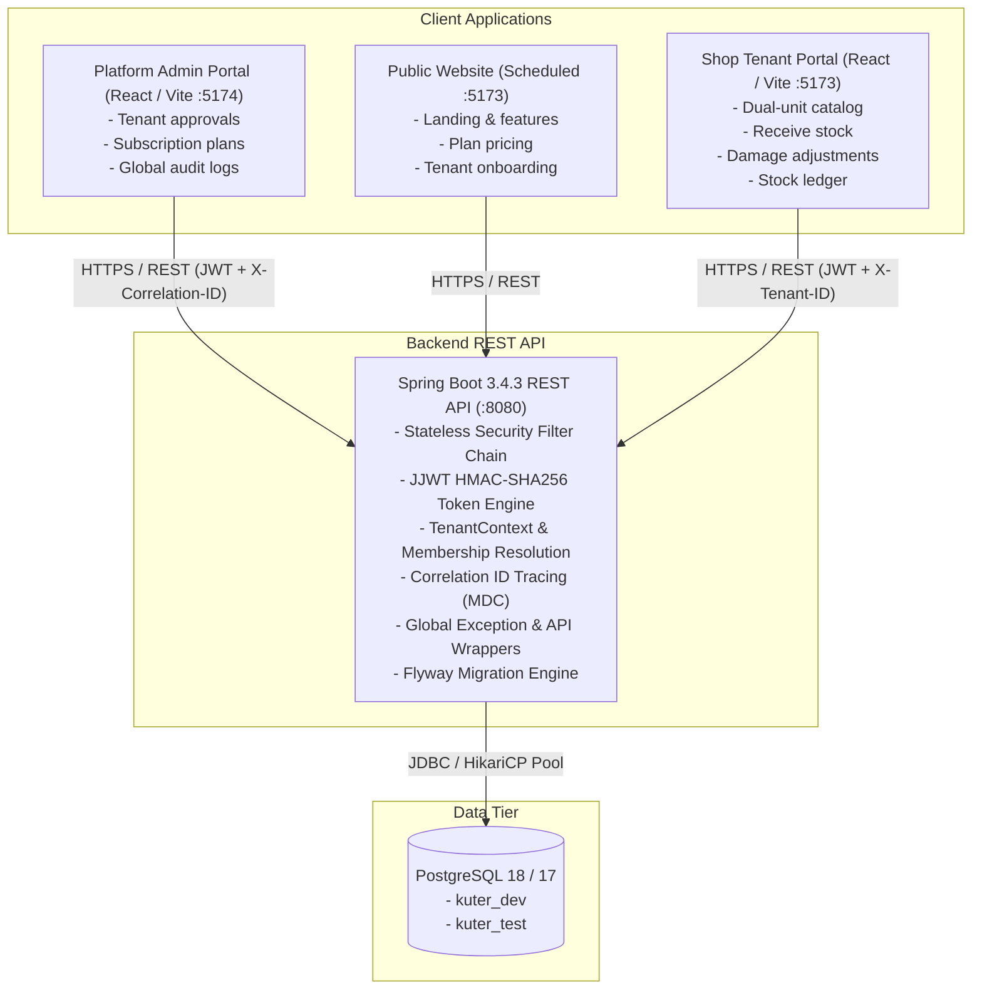

# Kuter — Architecture & Technical Design

## 1. Executive Summary

**Kuter** is a modern multi-tenant SaaS platform tailored specifically for the **building materials supply and retail industry** (e.g., bulk cement, structural steel rebar, timber, blocks, paints, and sanitary ware).

The system addresses unique industry challenges:
- **Dual Units of Measure (UOM):** Reconciling wholesale bulk receipts (metric tonnes, container loads, pallets, bundles) with counter retail sales (single bags, individual bars, sheets, pieces).
- **Multi-Tenant Data Isolation:** Providing independent yard contexts, pricing rules, storekeeper roles, and ledgers for each subscribed merchant.
- **Strict Stock Auditability:** Append-only stock movement ledger tracking receipts, counter sales, returns, and damage/breakage adjustments.

---

## 2. System Architecture & Boundaries

The repository is structured as a decoupled multi-project workspace:

```text
kuter/
├── backend/            # Spring Boot REST API, JPA, Flyway, PostgreSQL persistence
├── admin/              # React 19 + TypeScript + Vite platform administration portal (:5174)
├── shop/               # React 19 + TypeScript + Vite shop-owner & shop-staff portal (:5173)
├── public/             # Public marketing website and registration (scheduled)
├── docs/               # Architecture, design tokens, environment specs, and reports
├── .gitignore          # Repository-wide protection for credentials and build artifacts
├── .env.example        # Reference environment variables template
└── docker-compose.yml  # Local development containerized PostgreSQL service
```

### Application Responsibilities



1. **`backend/` (Spring Boot 3.4.3 & Java 21):**
   - Serves as the authoritative business engine, persistence gateway, and authorization enforcement point.
   - Designed as a **Modular Monolith** with clear bounded contexts (`identity`, `onboarding`, `tenancy`, `catalog`, `inventory`, `sales`, `subscriptions`, `audit`, `health`).
   - Exclusively communicates via structured JSON REST endpoints under `/api/v1/*`.
2. **`admin/` (Platform Administration Portal):**
   - Dedicated portal for Kuter SaaS operators.
   - Manages platform-level concerns: reviewing tenant registration applications, configuring subscription plan quotas, monitoring platform revenue, and auditing administrative events.
3. **`shop/` (Tenant Shop Portal):**
   - Dedicated yard workspace for yard managers, storekeepers, and cashiers to manage products, log receipts, record damage, and inspect the stock ledger.
4. **`public/` (Public Marketing Website):**
   - Public Website: Product marketing, feature explanations, tier comparison, and merchant onboarding application.

---

## 3. Backend Modular Monolith Pattern

Rather than fragmenting into premature microservices with distributed transaction complexity, Kuter adopts a **Modular Monolith** architecture with strict package boundaries:

```text
com.kuter/
├── KuterApplication.java           # Spring Boot Application Entrypoint
├── config/                         # Infrastructure & Security Filters
│   ├── CorsConfig.java             # Allowed origin policies for admin (:5174) & frontend (:5173)
│   ├── SecurityConfig.java         # Stateless SecurityFilterChain, filter order, error handlers
│   ├── JwtService.java             # JJWT 0.12.6 HMAC-SHA256 issuance, parsing, and claims verification
│   ├── JwtAuthenticationFilter.java# Extracts Bearer token, loads KuterUserPrincipal, sets SecurityContext
│   └── TenantContextFilter.java    # Validates X-Tenant-ID, checks memberships and tenant status, sets ThreadLocal
├── common/                         # Cross-cutting primitives & mapped superclasses
│   ├── BaseEntity.java             # UUID primary key, createdAt/updatedAt audit timestamps
│   ├── TenantAware.java            # Tenant identity interface
│   ├── TenantAwareBaseEntity.java  # Non-updatable tenant_id mapping
│   ├── ApiResponse.java            # Standard success wrapper {success, message, data, timestamp}
│   ├── ErrorResponse.java          # Standard error wrapper {status, error, message, path, correlationId, timestamp}
│   ├── PageResponse.java           # Standard pagination envelope {content, page, size, totalElements, ...}
│   ├── Constants.java              # Endpoint routes, MDC keys, and HTTP headers
│   ├── CorrelationIdFilter.java    # End-to-end MDC request tracing
│   └── GlobalExceptionHandler.java # Uniform JSON error translation (400, 401, 403, 404, 409, 500)
├── tenancy/                        # Tenant & Context Management
│   ├── Tenant.java, TenantStatus.java, TenantRepository.java
│   ├── TenantContext.java          # ThreadLocal tenant storage
│   ├── TenantManagementService.java, TenantManagementServiceImpl.java
│   ├── TenantController.java       # GET/PUT /api/v1/tenants/me
│   ├── AdminTenantController.java  # Platform Admin CRUD: /api/v1/admin/tenants/**
│   └── TenantSecurityService.java  # SpEL evaluation @tenantSecurity.isMemberOf(#tenantId)
├── identity/                       # Authentication, Users, Roles & Memberships
│   ├── User.java, UserStatus.java, UserRepository.java
│   ├── TenantRole.java             # OWNER, MANAGER, STOREKEEPER, CASHIER, VIEWER
│   ├── TenantMembership.java, MembershipStatus.java, TenantMembershipRepository.java
│   ├── KuterUserPrincipal.java     # UserDetails encapsulating multi-tenant memberships & platform flag
│   ├── CustomUserDetailsService.java # Database-backed user & membership authentication
│   ├── AuthService.java, AuthServiceImpl.java # Login, logout, JWT generation, user profile
│   ├── TenantMembershipService.java, TenantMembershipServiceImpl.java # Member management & role assignment
│   ├── AuthController.java         # POST /api/v1/auth/login, POST /api/v1/auth/logout, GET /api/v1/auth/me
│   ├── UserController.java         # GET /api/v1/users/me
│   └── TenantMembershipController.java # /api/v1/tenants/{tenantId}/members/**
├── onboarding/                     # Merchant Registration Pipeline
│   ├── TenantOnboardingRequest.java, OnboardingStatus.java, TenantOnboardingRequestRepository.java
│   ├── OnboardingService.java, OnboardingServiceImpl.java # Registration submission, status check, review/approval
│   ├── PublicOnboardingController.java # POST /api/v1/onboarding-requests, GET .../status/{code}
│   └── AdminOnboardingController.java  # /api/v1/admin/onboarding-requests/** (list, detail, approve, reject)
├── subscriptions/                  # SaaS Tiers, Entitlements & Lifecycle Management
│   ├── SubscriptionPlan.java, BillingInterval.java, SubscriptionPlanRepository.java
│   ├── TenantSubscription.java, SubscriptionStatus.java, TenantSubscriptionRepository.java
│   ├── SubscriptionHistory.java, SubscriptionAction.java, SubscriptionHistoryRepository.java
│   ├── SubscriptionService.java, SubscriptionServiceImpl.java (Lifecycle transitions, extensions, suspensions, MRR summaries)
│   ├── EntitlementService.java, EntitlementServiceImpl.java (Effective status evaluation, product & user quota checks)
│   ├── SubscriptionExpiryScheduler.java (Scheduled batch expiration processor)
│   ├── SubscriptionPlanController.java (/api/v1/subscription-plans/**)
│   ├── PublicSubscriptionPlanController.java (/api/v1/public/subscription-plans)
│   ├── AdminSubscriptionController.java (/api/v1/admin/subscriptions/**)
│   ├── TenantSubscriptionController.java (/api/v1/me/subscription/**, /api/v1/tenants/me/subscription/**)
│   └── dto/                        # Plans, lifecycle transitions, usage stats, and history DTOs
├── catalog/                        # Product Catalog & Dual Units of Measure
│   ├── Category.java, CategoryRepository.java, CategoryService.java, CategoryServiceImpl.java, CategoryController.java
│   ├── UnitDefinition.java, UnitDefinitionRepository.java, UnitDefinitionService.java, UnitDefinitionServiceImpl.java, UnitDefinitionController.java
│   ├── Product.java, ProductStatus.java, ProductRepository.java, ProductService.java, ProductServiceImpl.java, ProductController.java
│   ├── ProductUnitConversion.java, ProductUnitConversionRepository.java
│   └── dto/                        # Category, UnitDefinition, and Product request/response DTOs
├── inventory/                      # Yard Balance & Immutable Stock Movement Ledger
│   ├── MovementType.java           # RECEIPT, SALE, ADJUSTMENT, RETURN
│   ├── StockBalance.java, StockBalanceRepository.java
│   ├── StockMovement.java, StockMovementRepository.java (Append-only physical ledger)
│   ├── StockReceiving.java, StockReceivingItem.java, StockReceivingRepository.java, StockReceivingItemRepository.java
│   ├── StockAdjustment.java, StockAdjustmentItem.java, StockAdjustmentRepository.java, StockAdjustmentItemRepository.java
│   ├── InventoryService.java, InventoryServiceImpl.java (WAC calculation, idempotency, pessimistic locking)
│   ├── InventoryController.java    # Receipts, adjustments, balances, movements, valuation & low-stock reports
│   └── dto/                        # Receiving, adjustment, balance, movement, and reporting DTOs
├── sales/                          # Counter Sales, POS Checkout & Operational Reporting
│   ├── Sale.java, SaleStatus.java, SaleRepository.java
│   ├── SaleItem.java, SaleItemRepository.java
│   ├── SaleService.java, SaleServiceImpl.java (Checkout, canonical lock ordering, voiding, receipts, reports)
│   ├── SaleController.java         # /api/v1/sales/** (checkout, inquiry, voiding, receipt, summary & product reports)
│   └── dto/                        # CreateSaleRequestDto, SaleResponseDto, VoidSaleRequestDto, SaleReceiptResponseDto, SalesSummaryReportDto, ProductSalesReportDto
├── audit/                          # Append-Only Audit Logging
│   ├── AuditLog.java, AuditLogRepository.java
│   └── AuditService.java, AuditServiceImpl.java
└── health/                         # Foundation verification module
    ├── SystemStatus.java, SystemStatusRepository.java
    ├── HealthResponse.java, HealthService.java, HealthServiceImpl.java
    └── HealthController.java
```

### Clean Architectural Guidelines

1. **Thin REST Controllers:** Controllers validate incoming requests (`@Valid`), delegate immediately to services, and return standardized `ApiResponse<T>` envelopes.
2. **DTO Isolation:** Entity models are never directly exposed to HTTP clients or returned in REST responses. Separate request and response DTOs are maintained for all endpoints.
3. **End-to-End Tracing:** Every HTTP request passes through `CorrelationIdFilter`, which populates `X-Correlation-ID` into SLF4J MDC, enabling consistent logging and response header tracking.
4. **No DDL in Hibernate:** Flyway owns schema evolution exclusively. `spring.jpa.hibernate.ddl-auto` is strictly set to `validate` across all profiles.
5. **Discriminator Column Isolation:** Every tenant entity inherits `tenant_id` from `TenantAwareBaseEntity`. Repositories scope all queries with `findByTenantIdAnd*`.

---

### 3.1 Sales Processing & Concurrency Architecture

The counter sales engine operates under strict retail concurrency constraints while preserving ledger integrity:

1. **Atomic Counter Checkout Flow:**
   - Single-operation checkout (`POST /api/v1/sales`) combines cart creation, inventory balance deduction, moving WAC cost snapshotting, and immutable ledger logging in a single atomic `@Transactional` boundary.
   - Dual-UOM sales support allows selling in secondary units (e.g. 2 bundles of steel rebar) while transparently deducting base units (e.g. 40 individual bars) from physical yard stock.
2. **Canonical Lock Ordering (Deadlock Prevention):**
   - High-throughput counters processing overlapping multi-item carts simultaneously risk cyclic deadlocks (Cart A locks Product 1 then Product 2; Cart B locks Product 2 then Product 1).
   - Kuter enforces deterministic lock acquisition: all unique product IDs in the checkout cart are extracted, deduplicated, and sorted in natural UUID order (`sortedProductIds = productIds.stream().distinct().sorted().toList()`).
   - Row-level write locks (`SELECT ... FOR UPDATE` via `findWithLockByTenantIdAndProductId`) are acquired strictly in this sorted order, mathematically eliminating cyclic deadlocks.
3. **Cost Snapshot Immutability:**
   - Every `SaleItem` records the unit moving weighted-average cost (`unitCost`) and extended cost (`totalCost`) at the exact millisecond of checkout.
   - Future supplier deliveries that alter inventory moving average cost do not affect historical sale cost or gross profit margins.
4. **Controlled Sale Voiding & Valuation Restoration:**
   - Completed sales can be voided (`POST /api/v1/sales/{id}/void`) with mandatory business reasoning.
   - Compensating stock movements are logged with `MovementType.RETURN` and reference `SALE_VOID`.
   - Inventory on-hand balances are restored under pessimistic lock, and moving weighted-average cost is recomputed using the returned goods valuation:
     $$\bar{C}_{\text{new}} = \frac{(Q_{\text{current}} \times \bar{C}_{\text{current}}) + (Q_{\text{returned}} \times C_{\text{item}})}{Q_{\text{current}} + Q_{\text{returned}}}$$
5. **Operational Printable Receipt:**
   - Generates formatted receipt data (`GET /api/v1/sales/{id}/receipt`) with shop metadata, cashier name, line items, and an explicit operational disclaimer: *"Operational Sales Record - Not a Proof of Payment"*.
6. **Cashier Privacy & Financial Protection:**
   - Proprietary wholesale costs and gross margins are sensitive.
   - For users with the `CASHIER` role, `SaleServiceImpl` strictly redacts `totalCostOfGoodsSold`, `grossProfit`, `profitMarginPercentage`, `unitCost`, and `totalCost`, omitting these fields from API output via `@JsonInclude(NON_NULL)`.
7. **Idempotency Replay Protection:**
   - High-speed checkout terminals and network retry policies are protected by `uk_sales_tenant_idempotency`. Replaying the same key safely returns the original finalized sale without duplicate stock deductions.

---

## 4. Multi-Tenant Architecture Strategy

Building material supply businesses require strict operational isolation while benefiting from shared infrastructure economics:

1. **Tenant Identification:**
   - Authenticated requests carry tenant context resolved via the `X-Tenant-ID` header and cryptographically validated against the user's active memberships.
   - Single-tenant users have their tenant context automatically activated if the header is omitted.
2. **Database Isolation Strategy:**
   - **Pooled Schema with Tenant Discrimination:** All tables include a non-nullable `tenant_id UUID NOT NULL` foreign key.
   - **Lifecycle Enforcement:** The security filter checks `Tenant.status`. If `SUSPENDED`, requests are immediately rejected with 403 Forbidden.
   - **Enterprise Extension:** For enterprise distributors requiring dedicated compliance, the modular structure allows isolating tenants into dedicated PostgreSQL schemas or separate databases without rewriting business logic.

---

## 5. PostgreSQL & Database Migration Strategy

1. **Migration Tooling:** Managed exclusively via **Flyway** (`flyway-core` + `flyway-database-postgresql`).
2. **Version Control:** Migrations reside in `backend/src/main/resources/db/migration/`:
   - `V1__initial_schema.sql`: System status baseline and initialization record.
   - `V2__core_domain_schema.sql`: Tenants, users, memberships, catalog, stock ledger, sales, subscriptions, and audit tables.
   - `V3__onboarding_requests.sql`: Onboarding request schema extensions (currency, address, notes, shop code) and default subscription plan seeds.
    - `V4__inventory_enhancements.sql`: Idempotency keys on receipts and adjustments, product image storage keys, composite performance indexes for catalog, movements, and stock balances.
    - `V5__sales_enhancements.sql`: Cashier tracking, idempotency key, notes, and void metadata on `sales`; snapshot names, SKUs, and item discounts on `sale_items`; composite performance and idempotency indexes.
    - `V6__subscription_enhancements.sql`: Subscription plan currency and trial days; tenant subscription lifecycle metadata (trial, cancellation, suspension, last modified by, notes, is_current, version); immutable `subscription_history` audit ledger table; composite performance indexes for real-time entitlement checks and scheduled sweeps.
3. **Immutability:** Applied migrations are never edited. Fixes are committed as forward-only migrations.

---

## 6. Key Decisions and Assumptions

| Decision | Context | Rationale | Alternatives Considered |
| :--- | :--- | :--- | :--- |
| **Java 21 LTS** | Foundation runtime | Modern virtual threads, pattern matching, record types, long-term support. | Java 17 |
| **Spring Boot 3.4.3** | Framework standard | Aligned with reference project (Amoudi), modern Jakarta EE, production stability. | Quarkus, Micronaut |
| **PostgreSQL 18 / 17** | Relational storage | Advanced JSONB, ACID transactions, robust locking for stock ledger concurrency. | MySQL, MongoDB |
| **Stateless JWT (JJWT 0.12.6)** | Token Engine | HMAC-SHA256 tokens, horizontally scalable, no server session overhead. | Stateful HTTP Sessions, Redis Session |
| **Moving Weighted-Average Cost (WAC)** | Inventory Costing | Real-time valuation recalculation on every inbound receipt; preserves cost during downward adjustments. | FIFO (complex lot tracking), LIFO (disallowed under IFRS) |
| **Pessimistic Write Locking** | Stock Balances Concurrency | `SELECT ... FOR UPDATE` prevents race conditions and negative inventory balances during simultaneous transactions. | Optimistic locking (high retry abort rate under high concurrency) |
| **Canonical Lock Ordering** | Sales Concurrency | Sorting cart product IDs deterministically before acquiring row locks mathematically eliminates cyclic deadlocks. | Random order locking with retry loops |
| **Cost Snapshot Immutability** | Sales Margin Tracking | Capturing WAC at checkout timestamp preserves historical profit margins regardless of future inventory receipts. | Recalculating margins dynamically |
| **Cashier Metric Redaction** | Sales Reporting & Privacy | Hiding cost and profit margins from cashier roles protects merchant pricing strategy and wholesale supplier relationships. | Uniform access across all shop roles |
| **Operational Receipt Boundary** | Receipt Layout | Explicitly marking receipts as operational store records (not proofs of payment) clarifies scope and preserves audit compliance. | Fiscal tax invoice generator |
| **Real-Time Effective Status** | Subscription Entitlements | Dynamically evaluating period end with an injectable `Clock` prevents access bypass by stale tokens or delayed background batch jobs. | Relying solely on periodic cron schedulers |
| **Downgrade Data Preservation** | Plan Quotas | Preserving all existing catalog and staff data during tier downgrades prevents accidental business disruption while blocking new quota additions. | Truncating or archiving excess records |
| **Immutable Subscription Ledger** | Lifecycle Auditing | Maintaining a dedicated append-only `subscription_history` ledger records all lifecycle actions, reasons, and actors. | Relying solely on generic application audit logs |
| **Dual Units of Measure (UOM)** | Catalog & Inventory | Products tracked in canonical base unit with flexible conversion factors for wholesale bulk purchasing and retail sales. | Single unit per SKU |
| **Vite 6 + React 19** | Frontend build system | Sub-second HMR, modern ES modules, native TypeScript support, optimized production chunking. | Next.js, Create React App |
| **Separate Admin & Frontend Apps** | Portal structure | Platform operators and tenant shop users have separate permission lifecycles, route trees, and bundle sizes. | Monolithic SPA |
