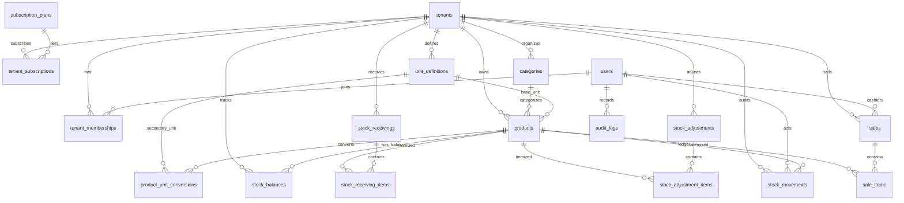

# Kuter — Database Design & Schema Architecture

## 1. Executive Summary

The database architecture for **Kuter** is engineered specifically for multi-tenant SaaS inventory management in the building materials industry. It addresses high-concurrency yard transactions, immutable stock movement audit trails, complex unit conversions (e.g. bulk tonnes to retail bags), and strict tenant data isolation.

Flyway versioned migrations (`V1__initial_schema.sql`, `V2__core_domain_schema.sql`, `V3__onboarding_requests.sql`, `V4__inventory_enhancements.sql`) serve as the single source of truth. Hibernate operates in `validate` mode across development, testing, and production.

---

## 2. Entity Relationship Diagram (ERD)



---

## 3. Key Design Decisions

### 3.1 Primary Key Strategy: UUID vs. BigInt

Kuter uses **`UUID` (Universally Unique Identifier)** as the primary key type for all database entities.

**Rationale:**
1. **Enumeration Attack Prevention:** Sequential integers (`BIGINT SERIAL`) permit competitors or unauthorized actors to infer sales volumes, tenant counts, or transaction numbers by simply guessing sequential IDs (`/api/v1/sales/1001` vs `/api/v1/sales/1002`).
2. **Distributed & Offline Generation:** In remote lumber yards and cement depots, mobile devices or point-of-sale tablets may operate during intermittent connectivity. Client or worker nodes can safely generate IDs prior to database persistence without ID range collisions.
3. **Data Export & Migration Freedom:** If a shop extracts its data, backups, or moves between physical database shards in future scaling phases, UUID keys guarantee global uniqueness without sequence remapping.
4. **Platform vs Tenant ID Segregation:** Prevents accidental ID overlap across completely different entities.

### 3.2 Numeric Precision & Scale: `NUMERIC(15, 4)` and `BigDecimal`

All financial amounts (prices, costs, subtotals, taxes, totals) and physical quantities (balances, received quantities, sales, conversion factors) use **`NUMERIC(15, 4)`** in PostgreSQL and `java.math.BigDecimal` in Java.

**Rationale:**
1. **Fractional Physical Inventory:** Building materials are frequently measured and sold in decimal quantities:
   - Aggregates and gravel: `2.7500` metric tonnes
   - Structural timber: `4.2500` running meters
   - Rebar by weight: `0.8500` metric tonnes
2. **Unit Conversion Accuracy:** Multipliers like `0.0200` (1 bag = 0.02 tonnes) require multi-decimal precision. Floating-point types (`FLOAT`, `DOUBLE`) introduce IEEE 754 binary rounding errors that corrupt inventory ledgers and financial balances over time.
3. **Financial Rounding Integrity:** Storing unit costs and prices to 4 decimal places allows precise average cost calculations without premature truncation errors.

### 3.3 Dual Units of Measure (UOM) Architecture

Building materials shops purchase materials in bulk wholesale units and retail them in smaller divisible units:

```text
Wholesale Receiving: 20 Metric Tonnes of Cement (1 Tonne = 20 Bags)
Normalized Stock Balance: 400 Bags (Base Unit)
Retail Sale: 5 Bags (Deducted directly from base balance)
Secondary Sale: 1 Pallet (40 Bags) -> Converted to 40 base bags
```

- Each product designates a **`base_unit_id`** in `unit_definitions`. This is the canonical unit in which `stock_balances` and `stock_movements` are tracked.
- Secondary units are modeled in `product_unit_conversions`:
  - `conversion_factor`: The multiplier to convert secondary unit into base unit.
  - Formula: $\text{base\_quantity} = \text{secondary\_quantity} \times \text{conversion\_factor}$.
  - Unique constraint: `(product_id, unit_id)` prevents conflicting conversion factors for the same material.

---

## 4. Module-by-Module Schema Specifications

### 4.1 Tenancy & Identity

#### `tenants`
| Column | Type | Constraints | Description |
|---|---|---|---|
| `id` | `UUID` | `PRIMARY KEY` | Unique tenant identifier |
| `code` | `VARCHAR(50)` | `NOT NULL UNIQUE` | URL-safe slug (e.g. `alpha-hardware`) |
| `name` | `VARCHAR(255)` | `NOT NULL` | Registered trading name |
| `business_registration_number` | `VARCHAR(100)` | `NULL` | Official corporate registration |
| `status` | `VARCHAR(50)` | `NOT NULL DEFAULT 'ACTIVE'` | `ACTIVE`, `SUSPENDED`, `CANCELLED` |
| `currency` | `VARCHAR(10)` | `NOT NULL DEFAULT 'USD'` | Default ISO currency code |
| `timezone` | `VARCHAR(50)` | `NOT NULL DEFAULT 'UTC'` | Yard local timezone |
| `created_at` | `TIMESTAMP` | `NOT NULL` | Audit timestamp |
| `updated_at` | `TIMESTAMP` | `NOT NULL` | Audit timestamp |

#### `users`
| Column | Type | Constraints | Description |
|---|---|---|---|
| `id` | `UUID` | `PRIMARY KEY` | Unique user identifier |
| `email` | `VARCHAR(255)` | `NOT NULL UNIQUE` | Login email address |
| `password_hash` | `VARCHAR(255)` | `NOT NULL` | BCrypt encoded credential |
| `full_name` | `VARCHAR(255)` | `NOT NULL` | User full name |
| `phone_number` | `VARCHAR(50)` | `NULL` | Contact phone |
| `is_platform_admin` | `BOOLEAN` | `NOT NULL DEFAULT FALSE` | SaaS operator flag |
| `status` | `VARCHAR(50)` | `NOT NULL DEFAULT 'ACTIVE'` | `ACTIVE`, `INACTIVE`, `SUSPENDED` |
| `last_login_at` | `TIMESTAMP` | `NULL` | Last successful authentication |
| `created_at` | `TIMESTAMP` | `NOT NULL` | Record creation timestamp |
| `updated_at` | `TIMESTAMP` | `NOT NULL` | Record modification timestamp |

#### `tenant_memberships`
| Column | Type | Constraints | Description |
|---|---|---|---|
| `id` | `UUID` | `PRIMARY KEY` | Membership record ID |
| `tenant_id` | `UUID` | `NOT NULL FK tenants(id) ON DELETE CASCADE` | Associated tenant shop |
| `user_id` | `UUID` | `NOT NULL FK users(id) ON DELETE CASCADE` | Associated user |
| `role` | `VARCHAR(50)` | `NOT NULL` | `OWNER`, `MANAGER`, `STOREKEEPER`, `CASHIER`, `VIEWER` |
| `status` | `VARCHAR(50)` | `NOT NULL DEFAULT 'ACTIVE'` | `ACTIVE`, `INVITED`, `DEACTIVATED` |
| `created_at` | `TIMESTAMP` | `NOT NULL` | Creation timestamp |
| `updated_at` | `TIMESTAMP` | `NOT NULL` | Modification timestamp |

**Indexes & Constraints:**
- `CONSTRAINT uk_tenant_membership_user UNIQUE (tenant_id, user_id)`
- `CREATE INDEX idx_membership_tenant ON tenant_memberships (tenant_id)`
- `CREATE INDEX idx_membership_user ON tenant_memberships (user_id)`

---

### 4.2 Subscriptions & Onboarding

#### `subscription_plans`
| Column | Type | Constraints | Description |
|---|---|---|---|
| `id` | `UUID` | `PRIMARY KEY` | Plan identifier |
| `code` | `VARCHAR(50)` | `NOT NULL UNIQUE` | Plan code (e.g. `starter`, `growth`, `enterprise`) |
| `name` | `VARCHAR(100)` | `NOT NULL` | Display plan name |
| `description` | `TEXT` | `NULL` | Detailed plan description |
| `price` | `NUMERIC(15, 4)` | `NOT NULL` | Recurring subscription cost |
| `currency` | `VARCHAR(10)` | `NOT NULL DEFAULT 'USD'` | Currency code (`V6`) |
| `billing_interval` | `VARCHAR(20)` | `NOT NULL` | `MONTHLY`, `YEARLY` |
| `product_limit` | `INTEGER` | `NULL` | Maximum active product SKUs (null = unlimited) |
| `user_limit` | `INTEGER` | `NULL` | Maximum authorized staff seats (null = unlimited) |
| `branch_limit` | `INTEGER` | `NULL` | Maximum branches/locations (null = unlimited) |
| `trial_days` | `INTEGER` | `DEFAULT 14` | Evaluation duration in days (`V6`) |
| `features_summary` | `TEXT` | `NULL` | Comma-separated or descriptive feature entitlements |
| `is_public` | `BOOLEAN` | `NOT NULL DEFAULT TRUE` | Visible on public pricing directory |
| `is_active` | `BOOLEAN` | `NOT NULL DEFAULT TRUE` | Active for new subscription assignments |

#### `tenant_subscriptions`
| Column | Type | Constraints | Description |
|---|---|---|---|
| `id` | `UUID` | `PRIMARY KEY` | Subscription record ID |
| `tenant_id` | `UUID` | `NOT NULL FK tenants(id) ON DELETE CASCADE` | Subscribing shop |
| `plan_id` | `UUID` | `NOT NULL FK subscription_plans(id) RESTRICT` | Subscribed tier |
| `status` | `VARCHAR(50)` | `NOT NULL` | `PENDING`, `TRIALING`, `ACTIVE`, `PAST_DUE`, `EXPIRED`, `SUSPENDED`, `CANCELLED` |
| `current_period_start` | `TIMESTAMP WITH TIME ZONE` | `NOT NULL` | Current billing period start |
| `current_period_end` | `TIMESTAMP WITH TIME ZONE` | `NOT NULL` | Current billing period expiration |
| `trial_start` | `TIMESTAMP WITH TIME ZONE` | `NULL` | Evaluation start timestamp (`V6`) |
| `trial_end` | `TIMESTAMP WITH TIME ZONE` | `NULL` | Evaluation expiration timestamp (`V6`) |
| `cancelled_at` | `TIMESTAMP WITH TIME ZONE` | `NULL` | Termination timestamp (`V6`) |
| `cancellation_reason`| `TEXT` | `NULL` | Reason for cancellation (`V6`) |
| `suspended_at` | `TIMESTAMP WITH TIME ZONE` | `NULL` | Suspension timestamp (`V6`) |
| `suspension_reason` | `TEXT` | `NULL` | Reason for suspension (`V6`) |
| `last_modified_by` | `UUID` | `NULL FK users(id) SET NULL` | Last administrator actor ID (`V6`) |
| `notes` | `TEXT` | `NULL` | Internal administrative remarks (`V6`) |
| `is_current` | `BOOLEAN` | `NOT NULL DEFAULT TRUE` | Flags current tenant subscription (`V6`) |
| `cancel_at_period_end`| `BOOLEAN` | `NOT NULL DEFAULT FALSE` | Pending termination at period end |
| `version` | `BIGINT` | `NOT NULL DEFAULT 0` | Optimistic locking counter (`V6`) |

#### `subscription_history` (`V6`)
| Column | Type | Constraints | Description |
|---|---|---|---|
| `id` | `UUID` | `PRIMARY KEY` | History ledger record ID |
| `subscription_id` | `UUID` | `NULL FK tenant_subscriptions(id) ON DELETE CASCADE` | Subscription record |
| `tenant_id` | `UUID` | `NOT NULL FK tenants(id) ON DELETE CASCADE` | Tenant owner |
| `plan_id` | `UUID` | `NOT NULL FK subscription_plans(id) RESTRICT` | Referenced plan |
| `action` | `VARCHAR(50)` | `NOT NULL` | `ASSIGNED`, `ACTIVATED`, `TRIAL_STARTED`, `PLAN_CHANGED`, `EXTENDED`, `SUSPENDED`, `REACTIVATED`, `CANCELLED`, `EXPIRED` |
| `previous_status` | `VARCHAR(50)` | `NULL` | Previous subscription status |
| `new_status` | `VARCHAR(50)` | `NOT NULL` | New subscription status |
| `previous_plan_id` | `UUID` | `NULL` | Previous plan ID (for plan changes) |
| `new_plan_id` | `UUID` | `NULL` | New plan ID (for plan changes) |
| `previous_period_end`| `TIMESTAMP WITH TIME ZONE` | `NULL` | Previous period expiration |
| `new_period_end` | `TIMESTAMP WITH TIME ZONE` | `NULL` | New period expiration |
| `reason` | `TEXT` | `NULL` | Mandatory justification for extensions/suspensions |
| `actor_id` | `UUID` | `NULL FK users(id) SET NULL` | Performing admin user ID |
| `created_at` | `TIMESTAMP WITH TIME ZONE` | `NOT NULL DEFAULT NOW()` | Event recording timestamp |
| `updated_at` | `TIMESTAMP WITH TIME ZONE` | `NOT NULL DEFAULT NOW()` | Entity modification timestamp |

#### `tenant_onboarding_requests`
| Column | Type | Constraints | Description |
|---|---|---|---|
| `id` | `UUID` | `PRIMARY KEY` | Onboarding record ID |
| `reference_code` | `VARCHAR(50)` | `NOT NULL UNIQUE` | Tracking code (e.g. `REQ-2026-X1`) |
| `shop_name` | `VARCHAR(255)` | `NOT NULL` | Requested shop name |
| `owner_full_name` | `VARCHAR(255)` | `NOT NULL` | Applicant name |
| `owner_email` | `VARCHAR(255)` | `NOT NULL` | Applicant email |
| `requested_plan_code`| `VARCHAR(50)` | `NOT NULL` | Selected subscription tier |
| `status` | `VARCHAR(50)` | `NOT NULL DEFAULT 'PENDING'` | `PENDING`, `APPROVED`, `REJECTED` |
| `reviewer_id` | `UUID` | `NULL FK users(id) SET NULL` | Reviewing platform admin |
| `reviewed_at` | `TIMESTAMP` | `NULL` | Time of approval/rejection |

---

### 4.3 Catalog & Units of Measure

#### `categories`
| Column | Type | Constraints | Description |
|---|---|---|---|
| `id` | `UUID` | `PRIMARY KEY` | Category identifier |
| `tenant_id` | `UUID` | `NOT NULL FK tenants(id) CASCADE` | Tenant owner |
| `name` | `VARCHAR(100)` | `NOT NULL` | Category name |
| `description` | `TEXT` | `NULL` | Description |
| `active` | `BOOLEAN` | `NOT NULL DEFAULT TRUE` | Active status |

- `CONSTRAINT uk_categories_tenant_name UNIQUE (tenant_id, name)`

#### `unit_definitions`
| Column | Type | Constraints | Description |
|---|---|---|---|
| `id` | `UUID` | `PRIMARY KEY` | Unit identifier |
| `tenant_id` | `UUID` | `NOT NULL FK tenants(id) CASCADE` | Tenant owner |
| `code` | `VARCHAR(20)` | `NOT NULL` | Unit code (e.g. `PC`, `BAG`, `TON`) |
| `name` | `VARCHAR(100)` | `NOT NULL` | Unit name (e.g. `Piece`, `50kg Bag`) |

- `CONSTRAINT uk_units_tenant_code UNIQUE (tenant_id, code)`

#### `products`
| Column | Type | Constraints | Description |
|---|---|---|---|
| `id` | `UUID` | `PRIMARY KEY` | Product SKU ID |
| `tenant_id` | `UUID` | `NOT NULL FK tenants(id) CASCADE` | Tenant owner |
| `sku` | `VARCHAR(100)` | `NOT NULL` | Shop-level SKU (trimmed uppercase) |
| `name` | `VARCHAR(255)` | `NOT NULL` | Material name |
| `category_id` | `UUID` | `NULL FK categories(id) SET NULL` | Classification |
| `base_unit_id` | `UUID` | `NOT NULL FK unit_definitions(id) RESTRICT` | Base inventory unit |
| `cost_price` | `NUMERIC(15, 4)` | `NOT NULL DEFAULT 0.0000` | Current replacement cost |
| `selling_price` | `NUMERIC(15, 4)` | `NOT NULL DEFAULT 0.0000` | Default retail price |
| `reorder_threshold` | `NUMERIC(15, 4)` | `NOT NULL DEFAULT 0.0000` | Low-stock alert level |
| `status` | `VARCHAR(50)` | `NOT NULL DEFAULT 'ACTIVE'` | `ACTIVE`, `INACTIVE`, `DISCONTINUED` |
| `image_url` | `VARCHAR(1024)` | `NULL` | Public CDN image asset URL |
| `image_storage_key`| `VARCHAR(255)` | `NULL` | Object storage key (`V4`) |
| `barcode` | `VARCHAR(100)` | `NULL` | Scannable barcode |
| `brand` | `VARCHAR(100)` | `NULL` | Manufacturer / brand |

- `CONSTRAINT uk_products_tenant_sku UNIQUE (tenant_id, sku)`

#### `product_unit_conversions`
| Column | Type | Constraints | Description |
|---|---|---|---|
| `id` | `UUID` | `PRIMARY KEY` | Conversion record ID |
| `tenant_id` | `UUID` | `NOT NULL FK tenants(id) CASCADE` | Tenant owner |
| `product_id` | `UUID` | `NOT NULL FK products(id) CASCADE` | Associated product |
| `unit_id` | `UUID` | `NOT NULL FK unit_definitions(id) RESTRICT` | Secondary unit |
| `conversion_factor` | `NUMERIC(15, 4)` | `NOT NULL` | Multiplier to base unit |
| `is_selling_unit` | `BOOLEAN` | `NOT NULL DEFAULT TRUE` | Usable on sales invoices |
| `is_receiving_unit`| `BOOLEAN` | `NOT NULL DEFAULT TRUE` | Usable on supplier GRNs |

- `CONSTRAINT uk_product_unit_conversion UNIQUE (product_id, unit_id)`

---

### 4.4 Inventory & Stock Movements

#### `stock_balances`
| Column | Type | Constraints | Description |
|---|---|---|---|
| `id` | `UUID` | `PRIMARY KEY` | Balance record ID |
| `tenant_id` | `UUID` | `NOT NULL FK tenants(id) CASCADE` | Tenant owner |
| `product_id` | `UUID` | `NOT NULL FK products(id) CASCADE` | Material |
| `quantity_on_hand`| `NUMERIC(15, 4)` | `NOT NULL DEFAULT 0.0000` | Current physical count |
| `average_cost` | `NUMERIC(15, 4)` | `NOT NULL DEFAULT 0.0000` | Moving weighted average cost |
| `last_counted_at` | `TIMESTAMP` | `NULL` | Physical stock count audit |

- `CONSTRAINT uk_stock_balance_tenant_product UNIQUE (tenant_id, product_id)`

#### `stock_receivings` & `stock_receiving_items`
- `stock_receivings`: Inbound deliveries with `receiving_number`, `supplier_name`, `delivery_note_ref`, `total_cost`, and `idempotency_key` (`V4`).
  - `CONSTRAINT uk_receiving_tenant_number UNIQUE (tenant_id, receiving_number)`
  - `INDEX uk_receiving_tenant_idempotency UNIQUE (tenant_id, idempotency_key)`
- `stock_receiving_items`: Line items capturing `received_quantity`, `received_unit_id`, `conversion_factor`, `base_quantity`, `unit_cost`, and `total_cost`.

#### `stock_adjustments` & `stock_adjustment_items`
- `stock_adjustments`: Physical audit corrections with `adjustment_number`, `reason_code` (`DAMAGE`, `EXPIRY`, `SPILLAGE`, `THEFT`, `COUNT_CORRECTION`), `notes`, and `idempotency_key` (`V4`).
  - `CONSTRAINT uk_adj_tenant_number UNIQUE (tenant_id, adjustment_number)`
  - `INDEX uk_adj_tenant_idempotency UNIQUE (tenant_id, idempotency_key)`
- `stock_adjustment_items`: Line items recording adjusted product, signed `quantity_change`, and `unit_cost`.

#### `stock_movements` (Immutable Ledger)
| Column | Type | Constraints | Description |
|---|---|---|---|
| `id` | `UUID` | `PRIMARY KEY` | Movement entry ID |
| `tenant_id` | `UUID` | `NOT NULL FK tenants(id) CASCADE` | Tenant owner |
| `product_id` | `UUID` | `NOT NULL FK products(id) RESTRICT` | Material moved |
| `movement_type` | `VARCHAR(50)` | `NOT NULL` | `RECEIPT`, `SALE`, `ADJUSTMENT`, `RETURN` |
| `reference_id` | `UUID` | `NULL` | ID of source document |
| `reference_type`| `VARCHAR(50)` | `NULL` | `STOCK_RECEIVING`, `SALE`, `STOCK_ADJUSTMENT` |
| `quantity_change`| `NUMERIC(15, 4)` | `NOT NULL` | Signed delta in base units |
| `balance_after` | `NUMERIC(15, 4)` | `NOT NULL` | Resulting yard balance |
| `unit_cost` | `NUMERIC(15, 4)` | `NOT NULL` | Unit cost at movement |
| `actor_id` | `UUID` | `NULL FK users(id) SET NULL` | Operating user |
| `created_at` | `TIMESTAMP` | `NOT NULL` | Ledger timestamp |

---

### 4.5 Sales & Invoicing

#### `sales`
| Column | Type | Constraints | Description |
|---|---|---|---|
| `id` | `UUID` | `PRIMARY KEY` | Sale invoice ID |
| `tenant_id` | `UUID` | `NOT NULL FK tenants(id) CASCADE` | Tenant owner |
| `invoice_number` | `VARCHAR(100)` | `NOT NULL` | Human-readable sequential invoice (e.g. `INV-2026-10492`) |
| `customer_name` | `VARCHAR(255)` | `NULL` | Buyer name / commercial client |
| `customer_phone` | `VARCHAR(50)` | `NULL` | Contact phone |
| `status` | `VARCHAR(50)` | `NOT NULL DEFAULT 'COMPLETED'` | `COMPLETED`, `VOIDED`, `CANCELLED`, `REFUNDED` |
| `subtotal` | `NUMERIC(15, 4)` | `NOT NULL DEFAULT 0.0000` | Sum of item gross totals |
| `discount_amount`| `NUMERIC(15, 4)` | `NOT NULL DEFAULT 0.0000` | Total discount (line + header) |
| `tax_amount` | `NUMERIC(15, 4)` | `NOT NULL DEFAULT 0.0000` | Applicable tax |
| `total_amount` | `NUMERIC(15, 4)` | `NOT NULL DEFAULT 0.0000` | Final payable amount |
| `total_cost` | `NUMERIC(15, 4)` | `NOT NULL DEFAULT 0.0000` | Cumulative snapshotted WAC cost |
| `sold_at` | `TIMESTAMP` | `NOT NULL` | Sale finalization timestamp |
| `cashier_id` | `UUID` | `NULL FK users(id) SET NULL` | Performing cashier user |
| `idempotency_key`| `VARCHAR(100)` | `NULL` | POS terminal client replay key (`V5`) |
| `notes` | `TEXT` | `NULL` | Operational transaction notes (`V5`) |
| `void_reason` | `VARCHAR(500)` | `NULL` | Required audit reason for voiding (`V5`) |
| `voided_at` | `TIMESTAMP` | `NULL` | Timestamp of voiding event (`V5`) |
| `voided_by` | `UUID` | `NULL FK users(id) SET NULL` | Authorizing manager/owner (`V5`) |

- `CONSTRAINT uk_sales_tenant_invoice UNIQUE (tenant_id, invoice_number)`
- `INDEX uk_sales_tenant_idempotency UNIQUE (tenant_id, idempotency_key)`

#### `sale_items`
| Column | Type | Constraints | Description |
|---|---|---|---|
| `id` | `UUID` | `PRIMARY KEY` | Line item ID |
| `tenant_id` | `UUID` | `NOT NULL FK tenants(id) CASCADE` | Tenant owner |
| `sale_id` | `UUID` | `NOT NULL FK sales(id) CASCADE` | Parent sale invoice |
| `product_id` | `UUID` | `NOT NULL FK products(id) RESTRICT` | Material sold |
| `product_name` | `VARCHAR(255)` | `NULL` | Historical product name snapshot (`V5`) |
| `product_sku` | `VARCHAR(100)` | `NULL` | Historical SKU snapshot (`V5`) |
| `sold_unit_id` | `UUID` | `NOT NULL FK unit_definitions(id) RESTRICT` | Unit of measure sold |
| `sold_quantity` | `NUMERIC(15, 4)` | `NOT NULL` | Quantity in sold unit |
| `conversion_factor` | `NUMERIC(15, 4)` | `NOT NULL DEFAULT 1.0000` | Factor to base inventory unit |
| `base_quantity` | `NUMERIC(15, 4)` | `NOT NULL` | Quantity deducted from inventory |
| `unit_price` | `NUMERIC(15, 4)` | `NOT NULL` | Selling price per sold unit |
| `discount_amount`| `NUMERIC(15, 4)` | `NOT NULL DEFAULT 0.0000` | Line item discount amount (`V5`) |
| `total_price` | `NUMERIC(15, 4)` | `NOT NULL` | Net line total |
| `unit_cost` | `NUMERIC(15, 4)` | `NOT NULL DEFAULT 0.0000` | Snapshotted unit WAC cost |
| `total_cost` | `NUMERIC(15, 4)` | `NOT NULL DEFAULT 0.0000` | Snapshotted line WAC cost |

---

### 4.6 Audit Logging

#### `audit_logs`
| Column | Type | Constraints | Description |
|---|---|---|---|
| `id` | `UUID` | `PRIMARY KEY` | Audit log ID |
| `tenant_id` | `UUID` | `NULL FK tenants(id) SET NULL` | Context tenant (if tenant operation) |
| `actor_id` | `UUID` | `NULL FK users(id) SET NULL` | Performing user |
| `actor_email` | `VARCHAR(255)` | `NOT NULL` | User email for historical audit |
| `action` | `VARCHAR(100)` | `NOT NULL` | `PASSWORD_CHANGE`, `TENANT_ONBOARDED`, etc. |
| `entity_type` | `VARCHAR(100)` | `NOT NULL` | Domain entity name |
| `entity_id` | `VARCHAR(100)` | `NOT NULL` | Target entity ID |
| `details` | `TEXT` | `NULL` | Contextual change description |
| `ip_address` | `VARCHAR(50)` | `NULL` | Client IP address |
| `correlation_id`| `VARCHAR(64)` | `NULL` | Tracing correlation ID |
| `created_at` | `TIMESTAMP` | `NOT NULL` | Event timestamp |

---

## 5. Foreign Key & Deletion Cascade Policies

1. **`ON DELETE CASCADE`:** Applied strictly to child entities that have zero meaning without their parent:
   - `tenants` $\rightarrow$ `tenant_memberships`, `categories`, `products`, `stock_balances`, `stock_receivings`, `sales`.
   - `sales` $\rightarrow$ `sale_items`.
   - `stock_receivings` $\rightarrow$ `stock_receiving_items`.
2. **`ON DELETE RESTRICT`:** Applied to foundational definitions that must not be deleted while in active use:
   - `unit_definitions` cannot be deleted if referenced by any `products`, `product_unit_conversions`, `stock_receiving_items`, or `sale_items`.
   - `subscription_plans` cannot be deleted if active `tenant_subscriptions` refer to them.
3. **`ON DELETE SET NULL`:** Applied to optional audit/actor relations:
   - If a user account is deleted, their previous movements, approved applications, and audit entries preserve historical accuracy with `actor_id = NULL` while retaining `actor_email` and `details`.

---

## 6. Concurrency, Locking & Index Strategy

### 6.1 Pessimistic Locking on Inventory Balances
To prevent race conditions during concurrent stock operations (e.g., simultaneous inbound receipts and physical adjustments on the same product), Kuter employs JPA pessimistic write locking (`LockModeType.PESSIMISTIC_WRITE`):

```java
@Lock(LockModeType.PESSIMISTIC_WRITE)
@Query("SELECT b FROM StockBalance b WHERE b.tenantId = :tenantId AND b.product.id = :productId")
Optional<StockBalance> findByTenantIdAndProductIdForUpdate(
    @Param("tenantId") UUID tenantId,
    @Param("productId") UUID productId
);
```

In PostgreSQL, this emits `SELECT ... FOR UPDATE`, blocking concurrent write transactions on that specific product balance record until the active transaction commits. This guarantees that:
- Moving weighted-average cost is computed on exact current balance states.
- On-hand stock balances are never reduced below zero by competing adjustments.

### 6.2 Idempotency Key Tracking
In volatile yard network environments, mobile devices and POS terminals may retry HTTP `POST` requests upon connection timeouts. 
To guarantee safe retries without double-crediting inventory balances:
- Inbound receipts (`stock_receivings`) and stock adjustments (`stock_adjustments`) accept an optional client-supplied `idempotencyKey`.
- Unique indexes (`uk_receiving_tenant_idempotency` and `uk_adj_tenant_idempotency`) enforce tenant-scoped uniqueness at the database level.
- Upon receiving a duplicate key, the service layer retrieves and returns the previously processed transaction without applying duplicate balance deltas.

### 6.3 Performance Indexes (V4 Migration)
The following composite indexes were introduced in `V4__inventory_enhancements.sql` to optimize catalog browsing, stock ledger queries, and inventory reporting:

| Index Name | Table | Indexed Columns | Optimized Operations |
| :--- | :--- | :--- | :--- |
| `idx_products_tenant_sku_lookup` | `products` | `(tenant_id, sku)` | Point SKU lookups during barcode scanning & receiving |
| `idx_products_tenant_name` | `products` | `(tenant_id, name)` | Case-insensitive product catalog search |
| `idx_stock_movements_tenant_date` | `stock_movements` | `(tenant_id, created_at DESC)` | Audit ledger chronological inspection and pagination |
| `idx_stock_receivings_tenant_date`| `stock_receivings` | `(tenant_id, received_at DESC)`| Supplier receiving transaction history |
| `idx_stock_adjustments_tenant_date`| `stock_adjustments` | `(tenant_id, created_at DESC)` | Adjustment transaction history |
| `uk_receiving_tenant_idempotency` | `stock_receivings` | `(tenant_id, idempotency_key)` | Idempotency replay detection for stock receipts |
| `uk_adj_tenant_idempotency` | `stock_adjustments` | `(tenant_id, idempotency_key)` | Idempotency replay detection for stock adjustments |

### 6.4 Sales Performance & Idempotency Indexes (V5 Migration)
The following composite indexes and unique constraints were introduced in `V5__sales_enhancements.sql` to support high-throughput counter checkout, deadlock-free inventory locking, idempotency replay, and sales aggregation:

| Index Name | Table | Indexed Columns | Optimized Operations |
| :--- | :--- | :--- | :--- |
| `uk_sales_tenant_idempotency` | `sales` | `(tenant_id, idempotency_key)` | Unique constraint preventing duplicate counter sales & enabling safe client replays |
| `idx_sales_tenant_status` | `sales` | `(tenant_id, status)` | Fast filtering for completed vs voided sales |
| `idx_sales_tenant_sold_at` | `sales` | `(tenant_id, sold_at DESC)` | Chronological sales history, paginated listings, and date-range summary reports |
| `idx_sales_tenant_cashier` | `sales` | `(tenant_id, cashier_id)` | Cashier-specific sales performance audits |
| `idx_sale_items_tenant_product` | `sale_items` | `(tenant_id, product_id)` | Product sales ranking aggregations and revenue velocity metrics |

### 6.5 Subscription Lifecycle & Performance Indexes (V6 Migration)
The following composite indexes were introduced in `V6__subscription_enhancements.sql` to support real-time entitlement checks, background expiration batch processing, and audit inspection:

| Index Name | Table | Indexed Columns | Optimized Operations |
| :--- | :--- | :--- | :--- |
| `idx_sub_tenant_current` | `tenant_subscriptions` | `(tenant_id, is_current)` | Real-time effective status resolution & limit checks |
| `idx_sub_status_end` | `tenant_subscriptions` | `(status, current_period_end)` | Scheduled expiration sweep queries |
| `idx_sub_history_sub` | `subscription_history` | `(subscription_id)` | Audit trail lookup for specific subscriptions |
| `idx_sub_history_tenant` | `subscription_history` | `(tenant_id, created_at DESC)` | Chronological tenant subscription audit ledger |
