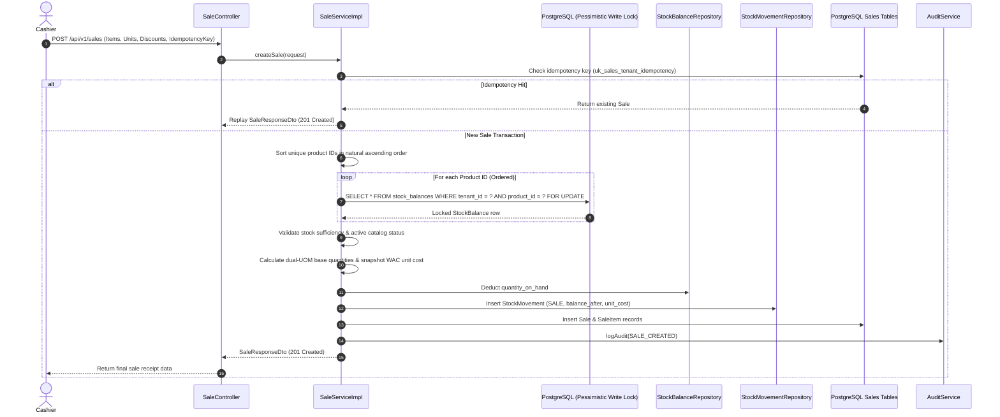

# Kuter Sales Processing & Operational Reporting Design

## 1. Executive Summary & Purpose

The **Sales Processing and Reporting Engine** in **Kuter** is engineered specifically for the operational demands of retail building materials yards. Counter checkout in a building materials merchant requires immediate single-operation checkout, flexible multi-product cart handling, dynamic selling in product-specific secondary units (e.g., selling paint in boxes or cement in tonnes while inventory is tracked in base units), atomic inventory balance deduction, moving weighted-average cost (WAC) valuation snapshots, idempotent replay protection, controlled order voiding with full stock reversal, operational receipt generation, and multi-tenant performance reporting.

This document formalizes the backend transactional architecture, concurrency control policies, mathematical costing formulations, role privacy protections, and reporting structures implemented in Phase Five.

---

## 2. Counter Sales Workflow & Atomic Finalization

### 2.1 Single-Operation Counter Checkout

Unlike traditional multi-step e-commerce workflows that involve separate cart creation, checkout initiation, payment gateway handshakes, and deferred fulfillment, building materials counter retail requires a **single atomic transaction**:
1. A builder or counter customer selects materials.
2. The cashier records items, selected units (base or conversion units), and optional line/header discounts.
3. A single `POST /api/v1/sales` request finalizes the sale, issues an invoice number, deducts on-hand inventory under pessimistic locks, snapshots moving average costs, records immutable stock movement ledger entries, and logs security audit records.



### 2.2 Dual-Unit of Measure (Dual-UOM) Sales Logic

Building materials merchants frequently inventory products in base units (e.g., *Pieces*, *Bags*, *Kilograms*) but sell them in secondary retail packaging (e.g., *Boxes of 4*, *Pallets of 50*, *Metric Tonnes*).

For each sale line item:
1. The client supplies `productId`, `unitDefinitionId`, `quantity`, and optional custom `unitPrice`.
2. The service inspects whether `unitDefinitionId` matches `product.baseUnitId`.
   - If **Base Unit**: `conversionFactor = 1.0000`.
   - If **Secondary Unit**: The service queries `ProductUnitConversion` for `(tenantId, productId, unitDefinitionId)` where `isSellingUnit = true`.
     $$\text{baseQuantity} = \text{soldQuantity} \times \text{conversionFactor}$$
   - If no valid conversion exists, the transaction fails immediately with `400 Bad Request`.
3. **Pricing Resolution**:
   - If custom `unitPrice` is supplied, it is respected as the unit price in the selected unit.
   - If `unitPrice` is omitted or null, the default price is calculated:
     $$\text{effectiveUnitPrice} = \text{product.sellingPrice} \times \text{conversionFactor}$$
4. **Line Total Calculation**:
   $$\text{lineSubtotal} = \text{soldQuantity} \times \text{effectiveUnitPrice}$$
   $$\text{lineTotal} = \text{lineSubtotal} - \text{lineDiscountAmount}$$

---

## 3. Concurrency Strategy & Deadlock Prevention

### 3.1 Pessimistic Write Locking (`SELECT ... FOR UPDATE`)

To prevent race conditions, lost updates, and inventory overdrafts when multiple sales terminals compete for limited stock:
- The service acquires a database write lock on `stock_balances` using Spring Data JPA `@Lock(LockModeType.PESSIMISTIC_WRITE)`.
- If on-hand stock is insufficient ($\text{quantityOnHand} < \text{requiredBaseQuantity}$), the transaction immediately rolls back and throws `BadRequestException` ("Insufficient stock for product X. Required: Y, Available: Z").
- The lock is held until the sale transaction commits or rolls back, ensuring strict serializability of inventory deductions.

### 3.2 Canonical Lock Ordering (Deadlock Avoidance)

In retail sales involving multiple products, deadlocks can occur if concurrent transactions lock inventory rows in opposing orders:
- *Transaction 1* locks Product A and waits to lock Product B.
- *Transaction 2* locks Product B and waits to lock Product A.
- Database deadlock detected $\rightarrow$ one transaction terminated with an error.

**Kuter's Deadlock Prevention Algorithm**:
Prior to acquiring any locks, `SaleServiceImpl` extracts all unique product IDs from the cart and sorts them in natural ascending UUID order:
```java
List<UUID> sortedProductIds = request.getItems().stream()
        .map(CreateSaleItemRequestDto::getProductId)
        .distinct()
        .sorted()
        .toList();
```
All concurrent threads acquire row locks in the exact same canonical order across all tables, eliminating cyclic dependency wait graphs.

---

## 4. Inventory Costing & Moving Average Valuation

### 4.1 Cost Snapshot at Time of Sale

In building materials retail, procurement costs fluctuate due to commodity prices (steel, cement, timber). Kuter applies a continuous **Moving Weighted-Average Cost (WAC)** model:
1. `StockBalance.averageCost` represents the exact weighted-average unit cost of goods on hand at the moment of sale.
2. When a sale is processed, `SaleItem.unitCost` is snapshotted directly from `StockBalance.averageCost`:
   $$\text{itemTotalCost} = \text{baseQuantity} \times \text{stockBalance.averageCost}$$
   $$\text{saleTotalCost} = \sum \text{itemTotalCost}$$
   $$\text{saleGrossProfit} = \text{saleTotalAmount} - \text{saleTotalCost}$$
3. **Cost Immutability**: Subsequent inbound stock receipts that alter `StockBalance.averageCost` do **not** retroactively affect completed sales. Historical sales records preserve the exact profit margin of the moment they occurred.

---

## 5. Controlled Sale Voiding & Stock Reversal

### 5.1 Business Rules & Authority Requirements

Voiding a finalized sale is a sensitive operational event restricted exclusively to `OWNER` and `MANAGER` roles (`canVoidSale()`). Cashiers and storekeepers are rejected with `403 Forbidden`.

Rules:
1. Only sales with status `COMPLETED` can be voided. Attempting to void a previously `VOIDED` sale returns `400 Bad Request`.
2. A non-blank `reason` is strictly required (`@NotBlank`).
3. The sale record is updated: `status = VOIDED`, `voidReason = reason`, `voidedAt = now()`, `voidedBy = actingUserId`.

### 5.2 Stock Restoration & Cost Valuation Adjustment

Voiding returns goods back into physical inventory:
1. For each line item, the locked `StockBalance` row is loaded under canonical order.
2. The inventory balance is incremented:
   $$\text{quantityOnHand}_{\text{new}} = \text{quantityOnHand}_{\text{current}} + \text{baseQuantity}_{\text{returned}}$$
3. **Valuation Recalculation**:
   If goods are returned into inventory, the moving average cost is recomputed to restore inventory valuation integrity:
   $$\bar{C}_{\text{new}} = \frac{(\text{quantityOnHand}_{\text{current}} \times \bar{C}_{\text{current}}) + (\text{baseQuantity}_{\text{returned}} \times \text{item.unitCost})}{\text{quantityOnHand}_{\text{new}}}$$
4. **Ledger Audit Movement**:
   A compensating `StockMovement` entry is written to the immutable ledger:
   - `movementType`: `RETURN`
   - `referenceType`: `SALE_VOID`
   - `referenceId`: `sale.id`
   - `quantityChange`: $+\text{baseQuantity}$
   - `balanceAfter`: $\text{quantityOnHand}_{\text{new}}$
   - `unitCost`: $\text{item.unitCost}$

---

## 6. Idempotency & Replay Protection

### 6.1 Database Unique Constraint

Network interruptions or double-clicks on counter POS terminals can duplicate sale submissions. Kuter enforces strict idempotency through a tenant-scoped unique index:
```sql
CREATE UNIQUE INDEX uk_sales_tenant_idempotency 
    ON sales (tenant_id, idempotency_key) 
    WHERE idempotency_key IS NOT NULL;
```

### 6.2 Idempotent Replay Workflow

1. Client provides an optional unique client-generated key (e.g., UUID or local POS transaction number) in `CreateSaleRequestDto.idempotencyKey`.
2. `SaleServiceImpl` queries `findByTenantIdAndIdempotencyKey(tenantId, idempotencyKey)`.
3. If an existing sale matches:
   - The transaction aborts stock deduction.
   - The previously created `SaleResponseDto` is returned immediately with `201 Created`.
4. If two requests race at the exact same millisecond:
   - One commits successfully.
   - The second triggers `DataIntegrityViolationException` on the unique index, caught by `GlobalExceptionHandler` which returns `409 Conflict`.
   - Any retry by the client safely hits step 2 and replays the completed sale without duplicate stock deductions.

---

## 7. Role-Based Privacy & Cashier Redaction

Building materials shop owners require counter cashiers to create sales, look up inventory, and issue receipts, but consider wholesale purchase costs and profit margins proprietary business secrets.

| Endpoint / Data | `OWNER` / `MANAGER` | `CASHIER` | `STOREKEEPER` |
|---|---|---|---|
| `POST /api/v1/sales` | Full response (with costs & margins) | Sanitized (costs & profits omitted) | `403 Forbidden` |
| `GET /api/v1/sales/{id}` | Full response | Sanitized | `403 Forbidden` |
| `GET /api/v1/sales` | Full response | Sanitized | `403 Forbidden` |
| `POST /api/v1/sales/{id}/void` | Authorized | `403 Forbidden` | `403 Forbidden` |
| `GET /api/v1/sales/{id}/receipt` | Operational receipt | Operational receipt | `403 Forbidden` |
| `GET /api/v1/sales/reports/summary` | Full financial metrics (COGS, Profit, Margin %) | Volume & Sales amounts only (Profit metrics omitted) | `403 Forbidden` |
| `GET /api/v1/sales/reports/products` | Full ranking with COGS & Gross Profit | Volume & Revenue only (Cost & Profit omitted) | `403 Forbidden` |

In DTOs, proprietary fields are annotated with `@JsonInclude(JsonInclude.Include.NON_NULL)`. When cashiers make requests, the service nulls these fields, removing them completely from the serialized JSON payload.

---

## 8. Operational Printable Receipt Specification

The receipt endpoint (`GET /api/v1/sales/{id}/receipt`) provides a lightweight, printable document model designed for thermal 80mm or standard A4 receipt printing.

### 8.1 Non-Payment Operational Disclaimer

Payments, credit accounts, and cash drawer reconciliations are intentionally outside the scope of Phase Five. To ensure legal and operational clarity, every printable receipt generated by Kuter includes an immutable header disclaimer:
> **"Operational Sales Record - Not a Proof of Payment"**

### 8.2 Receipt Schema

```json
{
  "shopName": "Alpha Hardware Ltd",
  "shopPhone": null,
  "shopEmail": null,
  "shopAddress": null,
  "shopCity": null,
  "shopCountry": null,
  "invoiceNumber": "INV-2026-10492",
  "soldAt": "2026-10-29T08:15:30Z",
  "cashierName": "Arthur Alpha",
  "customerName": "Ahmed Contractor",
  "customerPhone": "+254712345678",
  "items": [
    {
      "productName": "Portland Cement 50kg",
      "productSku": "CEM-50KG",
      "unitCode": "BAG",
      "quantity": 20.0000,
      "unitPrice": 12.0000,
      "discountAmount": 0.0000,
      "totalPrice": 240.0000
    }
  ],
  "subtotal": 240.0000,
  "discountAmount": 10.0000,
  "taxAmount": 0.0000,
  "totalAmount": 230.0000,
  "notes": "Delivered to site gate 3",
  "status": "COMPLETED",
  "voidReason": null,
  "voidedAt": null,
  "disclaimer": "Operational Sales Record - Not a Proof of Payment"
}
```

---

## 9. Sales Reporting & Performance Analytics

### 9.1 Sales Summary Report (`GET /api/v1/sales/reports/summary`)

Provides date-bounded operational performance metrics:
- **Total Sales Count**: Count of non-voided completed sales within the date range.
- **Total Sales Amount**: Net gross revenue of completed sales.
- **Total Cost of Goods Sold (COGS)**: Sum of snapshotted WAC costs (restricted to owners/managers).
- **Gross Profit**: $\text{Total Sales Amount} - \text{Total COGS}$ (restricted to owners/managers).
- **Gross Margin Percentage**: $(\text{Gross Profit} / \text{Total Sales Amount}) \times 100$.
- **Voided Sales Count & Amount**: Operational transparency for cancelled orders.
- **Daily Breakdowns**: Chronological time-series entries with daily sales count, revenue, and gross profit.

### 9.2 Product Ranking Report (`GET /api/v1/sales/reports/products`)

Ranks products sold within a date window by sales volume and revenue:
- Aggregates units sold converted to base units (`totalQuantitySold`).
- Computes aggregate revenue (`totalRevenue`) and transaction frequency (`transactionCount`).
- For owners and managers, computes cumulative product COGS and item-level gross profit.
