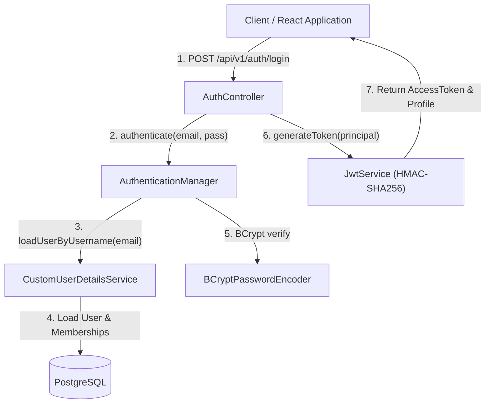
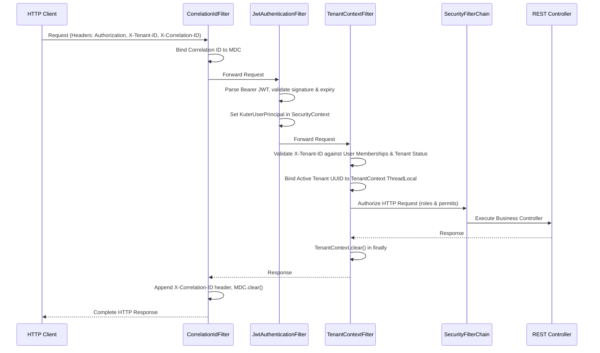

# Kuter — Security Architecture & Authentication Foundation

## 1. Overview

The security architecture of **Kuter** is engineered with zero-trust defaults, stateless authentication, multi-tenant role boundaries, and append-only audit logging.

Security operates across three tiers:
1. **Platform Administration Security:** Controls platform infrastructure, subscription quotas, and tenant onboarding approvals.
2. **Tenant Shop Security:** Controls access to yard catalog, inventory adjustments, receiving, and counter sales.
3. **Audit & Traceability:** Immutable logging of security events (credential changes, membership revocations, unauthorized access attempts).

---

## 2. Authentication & Token Architecture



### 2.1 Stateless JWT Architecture
Kuter employs stateless JSON Web Tokens (JWT) signed via **JJWT 0.12.6** using HMAC-SHA256:
- **Signing Key:** Sourced from `app.jwt.secret` (minimum 256 bits). In production, this is supplied securely via environment variables.
- **Expiration:** Configurable via `app.jwt.expiration-ms` (default 86,400,000 ms / 24 hours).
- **Token Claims:**
  - `sub`: User's primary email address.
  - `userId`: User's unique UUID.
  - `fullName`: User's display name.
  - `isPlatformAdmin`: Boolean flag indicating platform administrator privileges.
  - `iat`: Timestamp token was issued.
  - `exp`: Expiration timestamp.
- **Tenant Context Decoupling:** Tenant context is purposefully **not** hardcoded into the JWT payload. Because a single user identity can belong to multiple building materials yards with different roles, the active tenant context is resolved dynamically on each HTTP request via the `X-Tenant-ID` header and cryptographically validated against the user's active memberships.

### 2.2 Token Validation & Security Filter Chain
The security filter chain enforces sequential authentication and context verification:



### 2.3 Password Hashing & Encryption
- **Algorithm:** `BCryptPasswordEncoder` with standard cost factor 10.
- Passwords are salted and hashed upon user creation or credential update.
- Raw passwords are never logged, stored in memory beyond authentication processing, or exposed in JPA entities or API responses (`@JsonIgnore` on `User.passwordHash`).
- Login failures return a generic error message (`"Invalid username or password"`) regardless of whether the account exists, mitigating account enumeration attacks.
- Validated in [`AuthenticationAndSecurityTests.java`](file:///c:/D%20One/Projects/Kuter/backend/src/test/java/com/kuter/identity/AuthenticationAndSecurityTests.java) and [`AuthenticationApiTests.java`](file:///c:/D%20One/Projects/Kuter/backend/src/test/java/com/kuter/identity/AuthenticationApiTests.java).

---

## 3. Role & Permission Architecture

Kuter separates platform-wide roles from shop-specific roles:

```text
Platform Roles:
└── ROLE_PLATFORM_ADMIN     (Granted when is_platform_admin = true)

Tenant Shop Roles:
├── ROLE_TENANT_OWNER       (Full control of tenant shop, settings, staff, billing)
├── ROLE_TENANT_MANAGER     (Product pricing, inventory receiving, adjustments, reports)
├── ROLE_TENANT_STOREKEEPER (Receives stock shipments, records damage, physical counts)
├── ROLE_TENANT_CASHIER     (Counter sales invoices, walk-in receipts)
└── ROLE_TENANT_VIEWER      (Read-only catalog and stock view)
```

### 3.1 Multi-Tenant Membership Support
A single user identity can belong to multiple building materials shops with distinct roles. For example:
- User `sarah@materials.com` can be `OWNER` of *Shop A Materials* and `CASHIER` at *Shop B Hardware*.
- When Sarah requests context for *Shop A*, she acts with owner permissions.
- When Sarah requests context for *Shop B*, she acts with cashier permissions.
- Verified in [`AuthenticationAndSecurityTests.java`](file:///c:/D%20One/Projects/Kuter/backend/src/test/java/com/kuter/identity/AuthenticationAndSecurityTests.java).

### 3.2 Method Security & Tenant Isolation
Method-level security enforces granular access via [`TenantSecurityService`](file:///c:/D%20One/Projects/Kuter/backend/src/main/java/com/kuter/tenancy/TenantSecurityService.java):
```java
@PreAuthorize("@tenantSecurity.isMemberOf(#tenantId)")
@PreAuthorize("@tenantSecurity.canManageMembersOf(#tenantId)")
@PreAuthorize("@tenantSecurity.isPlatformAdmin()")
```
[`TenantSecurityService`](file:///c:/D%20One/Projects/Kuter/backend/src/main/java/com/kuter/tenancy/TenantSecurityService.java) evaluates whether the caller's principal currently holds an active membership in the specified tenant ID or has appropriate administrative rights.

---

## 4. HTTP Security Configuration

In [`SecurityConfig.java`](file:///c:/D%20One/Projects/Kuter/backend/src/main/java/com/kuter/config/SecurityConfig.java):

```java
@Bean
public SecurityFilterChain securityFilterChain(HttpSecurity http) throws Exception {
    http
        // Stateless REST API disables CSRF
        .csrf(AbstractHttpConfigurer::disable)
        .cors(cors -> cors.configurationSource(corsConfigurationSource))
        .sessionManagement(session -> session.sessionCreationPolicy(SessionCreationPolicy.STATELESS))
        .authorizeHttpRequests(auth -> auth
            // Public foundation endpoints
            .requestMatchers(HttpMethod.GET, Constants.HEALTH_ENDPOINT).permitAll()
            .requestMatchers(HttpMethod.GET, Constants.INFO_ENDPOINT).permitAll()
            .requestMatchers("/actuator/health", "/actuator/info").permitAll()
            .requestMatchers("/error").permitAll()

            // Public authentication and onboarding endpoints
            .requestMatchers(HttpMethod.POST, Constants.API_BASE_PATH + "/auth/login").permitAll()
            .requestMatchers(HttpMethod.POST, Constants.API_BASE_PATH + "/onboarding-requests").permitAll()
            .requestMatchers(HttpMethod.GET, Constants.API_BASE_PATH + "/onboarding-requests/status/**").permitAll()

            // All other endpoints require authentication
            .anyRequest().authenticated()
        )
        .authenticationProvider(authenticationProvider())
        .addFilterBefore(jwtAuthenticationFilter, UsernamePasswordAuthenticationFilter.class)
        .addFilterAfter(tenantContextFilter, JwtAuthenticationFilter.class)
        .exceptionHandling(exceptions -> exceptions
            .authenticationEntryPoint(restAuthenticationEntryPoint())
            .accessDeniedHandler(restAccessDeniedHandler())
        )
        .headers(headers -> headers
            .frameOptions(frame -> frame.deny())
            .referrerPolicy(referrer -> referrer.policy(ReferrerPolicyHeaderWriter.ReferrerPolicy.NO_REFERRER))
        );

    return http.build();
}
```

### Key Security Policies:
1. **Stateless Sessions:** Sessions are never stored in server memory (`STATELESS`), making the service horizontally scalable.
2. **CORS Isolation:** Only explicitly whitelisted origins (Admin portal `http://localhost:5174`, Frontend portal `http://localhost:5173`) are permitted.
3. **Structured JSON Errors:** Unauthenticated (`401`) or unauthorized (`403`) requests never return HTML error pages. They return standard [`ErrorResponse`](file:///c:/D%20One/Projects/Kuter/backend/src/main/java/com/kuter/common/ErrorResponse.java) JSON containing the correlation ID.
4. **Header Auditing:** All responses include `X-Correlation-ID` and `X-Request-ID`.
5. **Security Headers:** HTTP response headers include `X-Frame-Options: DENY`, `Referrer-Policy: no-referrer`, and `X-Content-Type-Options: nosniff`.

---

## 5. Audit Logging Architecture

[`AuditService`](file:///c:/D%20One/Projects/Kuter/backend/src/main/java/com/kuter/audit/AuditService.java) provides an append-only, tamper-evident record of security and administrative operations:
- Records `tenant_id`, `actor_id`, `actor_email`, `action`, `entity_type`, `entity_id`, `details`, `ip_address`, and `correlation_id`.
- Foreign key `fk_audit_actor` references `users(id)` with `ON DELETE SET NULL`, preserving audit history even if user records are removed.
- Validated in [`AuthenticationAndSecurityTests.java`](file:///c:/D%20One/Projects/Kuter/backend/src/test/java/com/kuter/identity/AuthenticationAndSecurityTests.java), [`OnboardingWorkflowTests.java`](file:///c:/D%20One/Projects/Kuter/backend/src/test/java/com/kuter/onboarding/OnboardingWorkflowTests.java), and [`TenantAndMembershipManagementTests.java`](file:///c:/D%20One/Projects/Kuter/backend/src/test/java/com/kuter/tenancy/TenantAndMembershipManagementTests.java).

---

## 6. Subscription Entitlement & Access Control Architecture (Phase Six)

### 6.1 Public Plan Access
- `GET /api/v1/public/subscription-plans` is configured as `permitAll()` in [`SecurityConfig.java`](file:///c:/D%20One/Projects/Kuter/backend/src/main/java/com/kuter/config/SecurityConfig.java).
- Prospective shop owners and landing page clients can query active public plans without credentials.

### 6.2 Administrative Role Segregation
- All endpoints under `/api/v1/subscription-plans` (CRUD) and `/api/v1/admin/subscriptions/**` (lifecycle transitions, MRR summaries) enforce `@PreAuthorize("hasRole('PLATFORM_ADMIN')")`.
- Tenant staff accounts attempting administrative operations are rejected with `HTTP 403 Forbidden`.

### 6.3 Dynamic Subscription Gating
- Gated write operations (`createSale`, `createProduct`, `addMember`) execute `entitlementService.assertActiveSubscription(tenantId)`.
- If effective subscription status is `EXPIRED`, `SUSPENDED`, `CANCELLED`, or `PENDING`, the request is rejected with `HTTP 403 Forbidden` and an informative message.
- Evaluation occurs in real-time against `current_period_end` using the injected `Clock` bean, ensuring expired shops cannot perform restricted operations regardless of background batch status.

### 6.4 Resource Quota Protection
- Catalog product additions execute `entitlementService.checkProductLimit(tenantId)`.
- Staff member invitations execute `entitlementService.checkUserLimit(tenantId)`.
- Requests exceeding tier limits are rejected with `HTTP 409 Conflict`. Existing data is strictly preserved upon plan downgrade.

### 6.5 Dual-Layer Audit Tracking
- All lifecycle events generate entries in the specialized immutable `subscription_history` ledger.
- In addition, an event is recorded in the centralized `audit_logs` table via `AuditService.logEvent(...)`.
