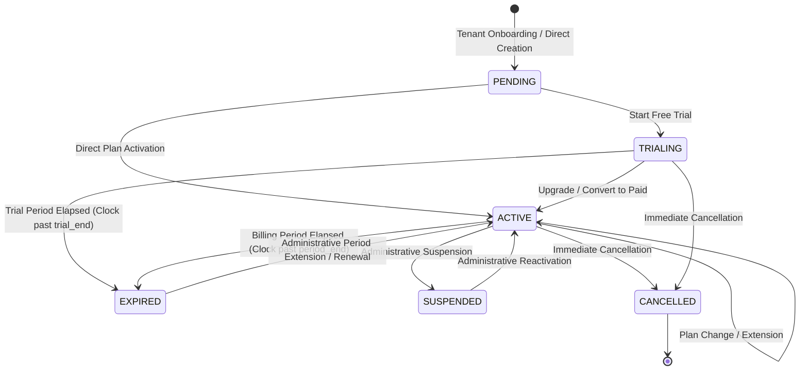
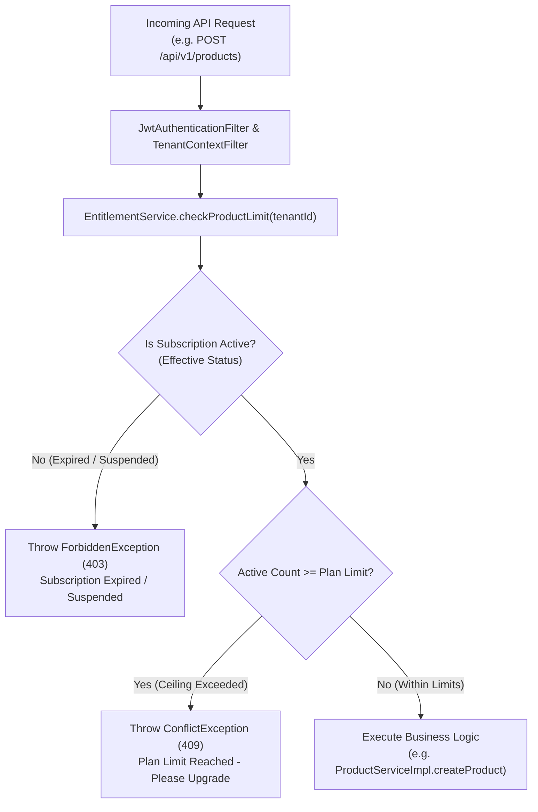

# Kuter — Subscription Management & Plan Entitlements Design

## 1. Overview

Kuter is a multi-tenant SaaS platform tailored for building-materials supply yards and hardware merchants. The subscription system governs tenant operational capabilities, enforcing tier-based feature entitlements and resource quotas while managing the end-to-end commercial lifecycle of tenant accounts.

In accordance with Phase Six architectural boundaries:
- **Commercial Metadata Only:** Plan prices (`NUMERIC(15, 4)` scale) and billing intervals represent descriptive commercial metadata. Payment gateway integrations (credit cards, automated recurring charging, Stripe/Mada) and general ledger accounts receivable are **strictly out of scope**.
- **Server-Side Enforcement:** Feature entitlements and resource ceilings (active products, active staff seats, and branch yards) are strictly enforced in core business services (`ProductServiceImpl`, `TenantMembershipServiceImpl`, `SaleServiceImpl`).
- **Data Preservation on Downgrade:** Plan downgrades never delete or truncate existing business data. Existing catalog items and staff memberships remain intact; further additions beyond the new plan ceiling are blocked with descriptive HTTP 409 Conflict responses.
- **Real-Time Dynamic Evaluation:** Effective subscription status is evaluated dynamically via an injectable `java.time.Clock` bean against `current_period_end` timestamps, ensuring authorization rules cannot be bypassed by stale cached tokens or delayed background batch jobs.

---

## 2. Subscription Lifecycle States & Transitions

### 2.1 State Definitions

| State | Code | Description | Restricted Access Permitted? |
|---|---|---|:---:|
| **Pending** | `PENDING` | Newly provisioned tenant awaiting onboarding activation or subscription setup. | ❌ No |
| **Trialing** | `TRIALING` | Active trial period granting access to plan features for a limited evaluation duration (`trial_days`). | ✅ Yes |
| **Active** | `ACTIVE` | Fully active, paid or active complimentary commercial subscription. | ✅ Yes |
| **Past Due** | `PAST_DUE` | Renewal payment grace period (transitional state). | ✅ Yes (grace window) |
| **Expired** | `EXPIRED` | Period end timestamp elapsed without renewal; write operations on catalog, inventory, sales, and staff are blocked. | ❌ No |
| **Suspended** | `SUSPENDED` | Account access frozen administratively by platform staff (e.g. Terms of Service violation, non-payment). | ❌ No |
| **Cancelled** | `CANCELLED` | Subscription terminated by shop request or platform administration. If `cancel_at_period_end` is true, status transitions at period end. | ❌ No |

---

### 2.2 Lifecycle State Transitions



### 2.3 State Transition Rules

1. **Activation:** Only subscriptions in `PENDING`, `TRIALING`, `EXPIRED`, or `SUSPENDED` can transition to `ACTIVE`. A cancelled subscription cannot be reactivated; a new subscription must be assigned.
2. **Extensions:** Any extension requires a mandatory, non-blank business justification (`reason`) logged to the immutable history ledger. Extending an expired subscription past the current clock immediately restores its stored status to `ACTIVE`.
3. **Suspensions:** Require a non-blank `suspensionReason` and timestamp `suspended_at`. All tenant-context requests for suspended shops return HTTP 403 Forbidden.
4. **Cancellations:**
   - *Immediate Cancellation (`immediate = true`):* Immediately sets status to `CANCELLED`, records `cancelled_at` and `cancellation_reason`, and blocks tenant write access.
   - *End-of-Period Cancellation (`immediate = false`):* Flags `cancel_at_period_end = true` while keeping status `ACTIVE` until `current_period_end`.
5. **Plan Changes:** Changes the referenced plan, validates that the target plan exists and is active, and immediately reapplies the new plan's resource limits. If effective limits are lower than existing usage, existing data is preserved without deletion.

---

## 3. Plan Entitlements & Resource Limits

### 3.1 Standard Tier Matrix

Kuter ships with three seeded production-ready subscription tiers:

| Tier | Code | Monthly Price | Product Limit | Staff User Limit | Branch Limit | Key Capabilities |
|---|---|---|---|---|---|---|
| **Starter** | `starter` | $49.0000 | 500 active products | 3 active users | 1 branch | Dual-UOM counter sales, stock receiving, physical inventory adjustments |
| **Growth** | `growth` | $119.0000 | 2,500 active products | 10 active users | 3 branches | Multi-branch stock ledger, delivery note receiving, cashier financial redaction |
| **Enterprise** | `enterprise` | $279.0000 | 10,000 active products | 50 active users | 10 branches | Priority support, custom unit conversions, bulk adjustments, full audit ledger |

*Note: Custom plans can be dynamically created, edited, activated, or retired at any time by Platform Administrators via `/api/v1/subscription-plans`.*

---

### 3.2 Server-Side Limit Enforcement Architecture

Resource limits are strictly enforced server-side inside transactional service boundaries:



#### Enforcement Points:
1. **Catalog Active Product Limit (`checkProductLimit`):**
   - Invoked in `ProductServiceImpl.createProduct(...)`.
   - Queries `productRepository.countByTenantIdAndStatus(tenantId, ProductStatus.ACTIVE)`.
   - If `count >= plan.getProductLimit()`, aborts transaction with HTTP 409 Conflict.
2. **Staff User Seat Limit (`checkUserLimit`):**
   - Invoked in `TenantMembershipServiceImpl.addMember(...)`.
   - Queries `membershipRepository.countByTenantIdAndStatus(tenantId, MembershipStatus.ACTIVE)`.
   - If `count >= plan.getUserLimit()`, aborts transaction with HTTP 409 Conflict.
3. **Restricted Operation Gating (`assertActiveSubscription`):**
   - Invoked in `SaleServiceImpl.createSale(...)`, `ProductServiceImpl.createProduct(...)`, and `TenantMembershipServiceImpl.addMember(...)`.
   - If effective status is `EXPIRED`, `SUSPENDED`, `CANCELLED`, or `PENDING`, aborts transaction with HTTP 403 Forbidden.

---

### 3.3 Plan Downgrade & Data Preservation Policy

When a tenant switches to a lower plan tier (e.g. downgrading from Growth with 800 products to Starter with a 500-product ceiling):
- **Zero Data Loss:** Existing products, catalog records, inventory balances, and staff accounts are **strictly preserved** and remain active.
- **Read & Operational Continuity:** Existing inventory can still be received, adjusted, counted, and sold.
- **Ceiling Lockout:** Attempting to create **new** products or add **new** staff is immediately rejected with HTTP 409 Conflict until the shop either:
  1. Archives/deactivates enough resources to drop below the plan ceiling, or
  2. Upgrades back to a higher plan tier.

---

## 4. Injectable Clock & Deterministic Expiry Resolution

### 4.1 Real-Time Effective Status (`getEffectiveStatus`)

Background schedulers running once an hour can suffer from clock skew, scheduler delays, or transient worker crashes. To guarantee absolute security, **authorization never relies solely on database status flags**.

`EntitlementService.getEffectiveStatus(tenantId)` evaluates status in real-time on every sensitive request:

```java
if (storedStatus == SubscriptionStatus.ACTIVE || storedStatus == SubscriptionStatus.TRIALING) {
    if (clock.instant().isAfter(sub.getCurrentPeriodEnd())) {
        return SubscriptionStatus.EXPIRED;
    }
    return storedStatus;
}
```

### 4.2 Deterministic Time-Travel Testing

Production uses `Clock.systemUTC()`, exposed as a Spring `@Bean` in `ClockConfig`. 

For automated test suites (`SubscriptionExpiryAndEntitlementTests`), the `Clock` bean is replaced or set to a fixed instant via `entitlementService.setClock(Clock.fixed(time, ZoneOffset.UTC))`:
- Tests advance time by days or months instantaneously without sleeping or hacking database clocks.
- Deterministic verification verifies that when `clock.instant()` passes `current_period_end`, write access is immediately blocked with HTTP 403 Forbidden.

---

## 5. Background Expiry Processing (`SubscriptionExpiryScheduler`)

While real-time access is evaluated dynamically, a background job periodically reconciles the persistent database records to maintain operational dashboards and automated email alerts:
- **Scheduler Bean:** `SubscriptionExpiryScheduler`
- **Configurable Cron:** `kuter.subscriptions.expiry-cron: "0 0 * * * *"` (Hourly by default)
- **Feature Flag:** `kuter.subscriptions.expiry-scheduler.enabled: true`
- **Batch Logic:** Queries all `ACTIVE` and `TRIALING` records where `current_period_end < clock.instant()`, updates their database status to `EXPIRED`, records an `EXPIRED` transition in `subscription_history`, and logs a structured event in `audit_logs`.

---

## 6. Immutable Subscription Audit History (`subscription_history`)

Every lifecycle event produces an immutable audit record in the `subscription_history` table:

```sql
CREATE TABLE IF NOT EXISTS subscription_history (
    id UUID PRIMARY KEY,
    subscription_id UUID REFERENCES tenant_subscriptions(id) ON DELETE CASCADE,
    tenant_id UUID NOT NULL REFERENCES tenants(id) ON DELETE CASCADE,
    plan_id UUID NOT NULL REFERENCES subscription_plans(id) ON DELETE RESTRICT,
    action VARCHAR(50) NOT NULL,
    previous_status VARCHAR(50),
    new_status VARCHAR(50) NOT NULL,
    previous_plan_id UUID,
    new_plan_id UUID,
    previous_period_end TIMESTAMP WITH TIME ZONE,
    new_period_end TIMESTAMP WITH TIME ZONE,
    reason TEXT,
    actor_id UUID REFERENCES users(id) ON DELETE SET NULL,
    created_at TIMESTAMP WITH TIME ZONE NOT NULL DEFAULT NOW(),
    updated_at TIMESTAMP WITH TIME ZONE NOT NULL DEFAULT NOW()
);
```

### Action Types Recorded:
- `ASSIGNED`: Initial subscription provisioning.
- `ACTIVATED`: Activated from pending, trialing, or expired.
- `TRIAL_STARTED`: Trial evaluation begun.
- `PLAN_CHANGED`: Upgraded or downgraded to a different tier.
- `EXTENDED`: End date extended by administrator with mandatory reason.
- `SUSPENDED`: Frozen administratively with mandatory reason.
- `REACTIVATED`: Restored after suspension.
- `CANCELLED`: Immediate or scheduled cancellation.
- `EXPIRED`: Automatic background expiration or period lapse.

---

## 7. Public vs Administrative vs Tenant Access Boundaries

1. **Public Catalog (`GET /api/v1/public/subscription-plans`):**
   - Unauthenticated access permitted (`permitAll()`).
   - Returns active and public plans only.
   - Strips internal administrative metadata (timestamps, soft delete flags, internal limits).
2. **Platform Admin APIs (`/api/v1/subscription-plans`, `/api/v1/admin/subscriptions/**`):**
   - Enforces `@PreAuthorize("hasRole('PLATFORM_ADMIN')")`.
   - Tenant users (`OWNER`, `MANAGER`, `CASHIER`) are rejected with HTTP 403 Forbidden.
   - Unauthenticated requests are rejected with HTTP 401 Unauthorized.
3. **Tenant Self-Inspection (`GET /api/v1/me/subscription`, `GET /api/v1/me/subscription/history`):**
   - Authenticated shop users inspect their current shop's plan details, resource limits, active usage counts, days remaining, and historical transitions.
   - Enforces `TenantContext`: Users cannot inspect or tamper with another shop's subscription.
